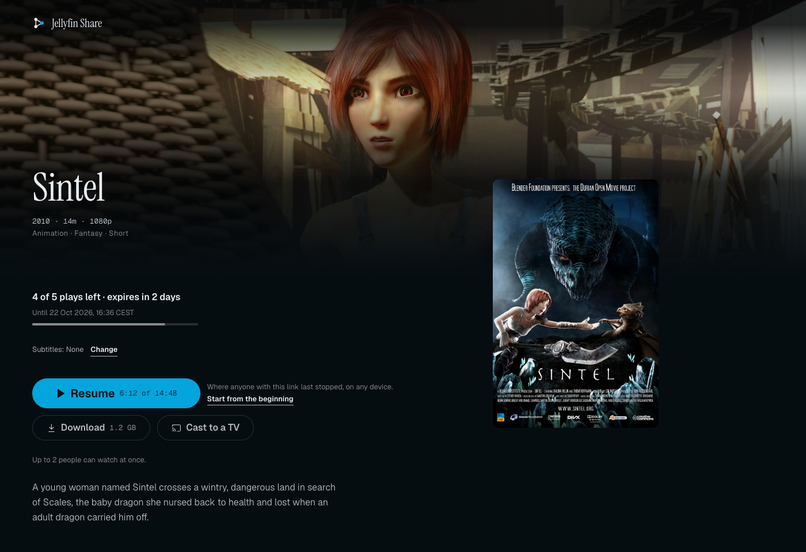
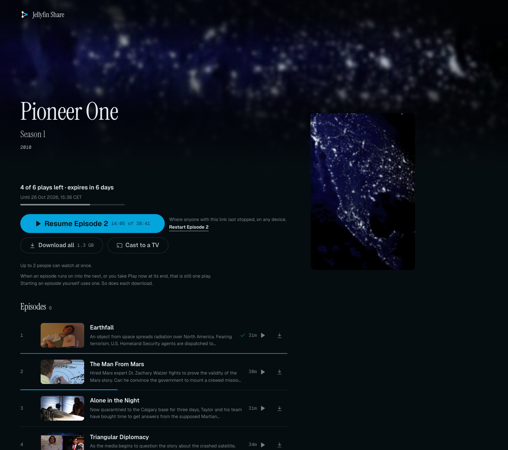
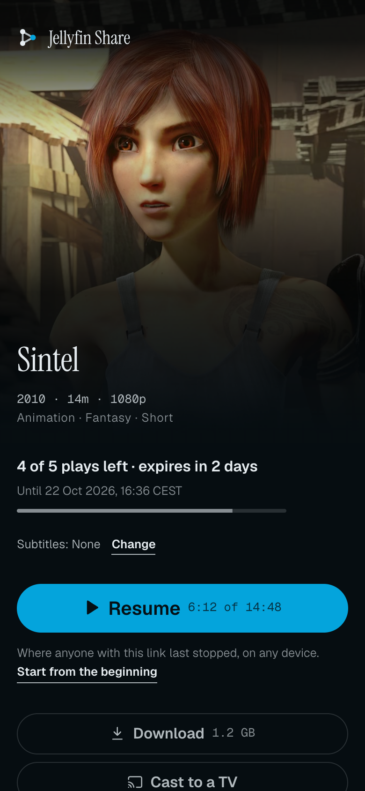
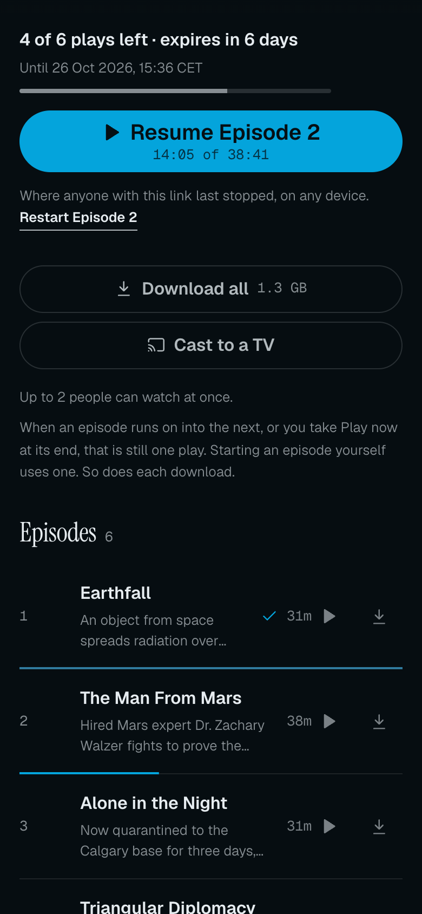
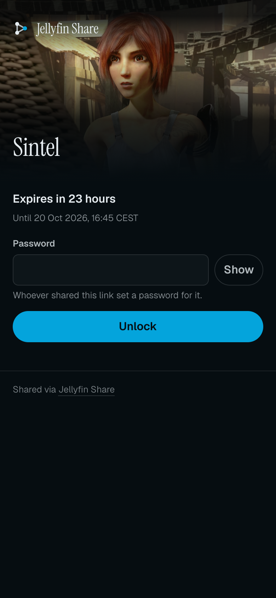
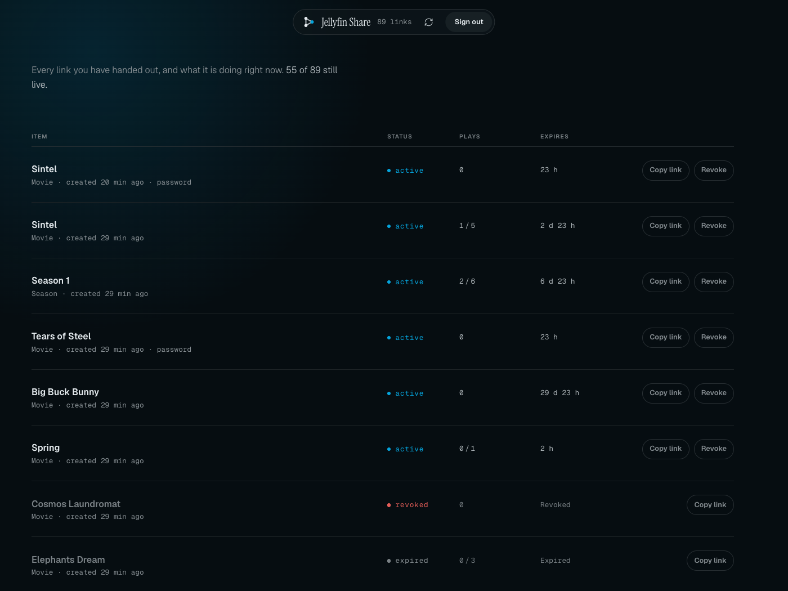

<p align="center">
  
</p>

<h1 align="center">Jellyfin Share</h1>

<p align="center">
  Temporary, limited links to a film, an episode, a season or a whole series on
  your Jellyfin server, for people who have no account on it.
</p>

> **A note on AI:** Jellyfin Share is developed by a human with AI assistance
> (mostly Claude Code) helping write, refactor and review code. It's not "vibe
> coded" or auto-generated: every change is reviewed, tested against a live
> Jellyfin and shipped intentionally. That said, I'm all in on AI as a
> development tool. It massively speeds up the work and lets a solo developer
> ship features and fixes at a pace that wouldn't be possible otherwise. I'm
> sharing this openly so you know what's behind the project.

A secure, self-hosted way to hand someone a link to your media without handing
them your Jellyfin server. The link carries its own terms: how long it lasts,
how often it can be played, how many people may watch at once, and an optional
password.

This is a fork of [monxas/jellyfin-share-backend](https://github.com/monxas/jellyfin-share-backend)
with Jellyfin 12 support, two security fixes, a reworked streaming path and a
redesigned interface. See [What this fork changes](#what-this-fork-changes).

## What it looks like

A shared film. The artwork Jellyfin already holds fills the page, and the
link's terms come first, in words: what is left and until when. Resume says
whose place it goes back to, because everyone holding a link shares its
progress, on any device. Subtitles, and the audio track where there is more
than one, can be changed before anything plays.



A shared season. Each episode shows its still, its overview and how much of it
has been watched on this link. An episode that runs on into the next one is
still the same play.



On a phone every action takes the full width, so no label is ever cut short,
and a password link keeps its field above the keyboard.

<p align="center">
  
  &nbsp;
  
  &nbsp;
  
</p>

The admin surface is one scannable index of every link handed out: what it points
at, whether it is still live, how often it has been played, and when it expires.



<sub>The screenshots show a free film and a free series with their real
metadata: [Sintel](https://durian.blender.org/) (Blender Foundation,
[CC BY 3.0](https://creativecommons.org/licenses/by/3.0/); poster via
[Wikimedia Commons](https://commons.wikimedia.org/wiki/File:Sintel_poster.jpg))
and [Pioneer One](https://archive.org/details/pioneer.one.season1.720p.x264-vodo)
(Josh Bernhard and Bracey Smith,
[CC BY-NC-SA 4.0](https://creativecommons.org/licenses/by-nc-sa/4.0/) as published
there), whose artwork and stills are frames from the episodes. Episode summaries
are from [Wikipedia](https://en.wikipedia.org/wiki/Pioneer_One)
([CC BY-SA 4.0](https://creativecommons.org/licenses/by-sa/4.0/)). The other titles in
the admin index are named only. The screenshots showing Pioneer One are shared
under [CC BY-NC-SA 4.0](https://creativecommons.org/licenses/by-nc-sa/4.0/), and the
episode summaries in them under
[CC BY-SA 4.0](https://creativecommons.org/licenses/by-sa/4.0/).</sub>

## Features

- **Temporary Share Links** - Create time-limited links that automatically expire
- **Password Protection** - Optionally protect shares with a password
- **Play Limits** - Set maximum total plays and concurrent viewer limits
- **No Account Required** - Recipients don't need a Jellyfin account
- **Terms Stated Up Front** - "Last of 5 plays · expires in 2 days" sits above
  Play, with the exact end beneath it and a meter of the plays left. The last
  play says what it costs before it is spent, and a link with nothing left says
  so instead of offering controls that could only fail
- **Plain-Language Refusals** - Every error says what happened, whether a play
  was used and what to do next, without codes. A dead link says whether it was
  revoked or expired, and since when
- **Secure Streaming** - Media is proxied through the backend; Jellyfin is never exposed
- **Rich Metadata** - Displays poster, backdrop, ratings, cast, and more
- **Admin Dashboard** - Web UI to manage and monitor all shares, paging through
  every link with counts kept on the server
- **Session Tracking** - Monitor active viewers and playback sessions
- **HLS Streaming** - Segments are served through the backend, never from Jellyfin
- **Browser-Compatible Playback** - The codec is negotiated with the viewer's browser,
  so an AV1 or HEVC library plays without being needlessly re-encoded for everyone
- **Audio and Subtitle Tracks** - Selectable before playback; text subtitles are
  delivered as a WebVTT sidecar, so the video needs no transcode and the viewer can
  switch them off
- **Downloads** - The original file of a film or episode, or a whole season or
  series as one ZIP filed by season. Each download counts as one play and, on a
  link with a play limit, asks first with the file's size and what it costs;
  whoever shares a link can switch downloads off for it
- **Resume and Next Episode** - The server remembers, per link, where it was left
  (on any device, also when watched on a TV), offers to resume, says whose place
  that is, and ticks what was watched; near the end of an episode a card offers
  the next one, which starts on its own unless the viewer cancels
- **Episode List** - Each episode with its overview and a bar for how much of
  it has been seen on this link, and Jellyfin's still on a wider screen
- **Casting** - Google Cast in Chromium browsers and AirPlay in Safari; while
  something plays on a TV the page says so and keeps track of where it is
- **Per-Share Quality** - Cap a single link at 1080p, 720p or 480p without touching
  the library or the server settings
- **Designed Interface** - The share page leads with the artwork Jellyfin already
  holds and states the link's terms in plain language; the admin surface is a
  single scannable index. Both follow one locked design system
  ([`design.md`](design.md)) anchored on Jellyfin's own accent colour
- **Phone and Keyboard** - Every page fits a phone without sideways scrolling
  and works by keyboard and screen reader: focus returns to where it was after
  the player closes, and each control says what it does

## Architecture

```
┌─────────────┐     ┌─────────────────┐     ┌─────────────┐
│   Viewer    │────▶│  JF Share API   │────▶│  Jellyfin   │
│  (Browser)  │◀────│   (Go + Svelte) │◀────│   Server    │
└─────────────┘     └─────────────────┘     └─────────────┘
                            │
                            ▼
                    ┌─────────────┐
                    │  PostgreSQL │
                    └─────────────┘
```

## Quick Start

### Prerequisites

- Docker and Docker Compose
- Jellyfin server with API key (10.11 or 12.x — both are supported)
- PostgreSQL (included in docker-compose)

### 1. Clone and Configure

```bash
git clone https://github.com/stanislavhannes/jellyfin-share-backend.git
cd jellyfin-share-backend

# Copy example environment file
cp .env.example .env
```

### 2. Edit `.env`

```env
# Your Jellyfin server URL
JELLYFIN_URL=http://your-jellyfin-server:8096

# Jellyfin API key (Dashboard → API Keys → Create)
JELLYFIN_API_KEY=your-jellyfin-api-key

# Backend API key for admin access (generate with: openssl rand -hex 32)
BACKEND_API_KEY=your-secure-backend-key

# Public URL where share links will be accessible
PUBLIC_BASE_URL=https://share.yourdomain.com

# Database password
POSTGRES_PASSWORD=your-secure-db-password
```

### 3. Start the Server

```bash
docker-compose up -d
```

The server will be available at `http://localhost:8097`

### 4. Access Admin Dashboard

Navigate to `http://localhost:8097/admin` and enter your `BACKEND_API_KEY`.

## Configuration

| Environment Variable | Description | Default |
|---------------------|-------------|---------|
| `JFSHARE_PORT` | Server port | `8097` |
| `JFSHARE_JELLYFIN_BASE_URL` | Jellyfin server URL | Required |
| `JFSHARE_JELLYFIN_API_KEY` | Jellyfin API key | Required |
| `JFSHARE_BACKEND_API_KEY` | Admin API key | Required |
| `JFSHARE_PUBLIC_BASE_URL` | Public URL for share links | Required |
| `JFSHARE_DB_DSN` | PostgreSQL connection string | Required |
| `JFSHARE_SESSION_HEARTBEAT_TIMEOUT_SECONDS` | Session timeout | `120` |
| `JFSHARE_RATE_LIMIT_REQUESTS` | Public API calls allowed per IP per window; images and stream segments have their own limit, ten times this | `100` |
| `JFSHARE_RATE_LIMIT_WINDOW_SECONDS` | Rate limit window | `60` |
| `JFSHARE_MAX_TRANSCODE_BITRATE` | Upper bound for a transcode target, in bits per second. Only applies when Jellyfin transcodes; direct stream is unaffected | `20000000` |
| `JFSHARE_STREAM_VIDEO_CODEC` | Fallback video codec, used when the viewer's browser cannot decode the source. A source that already matches is stream-copied, not re-encoded. Empty sends no preference, which lets AV1/HEVC reach the browser untouched | `h264` |
| `JFSHARE_STREAM_AUDIO_CODEC` | Audio codec the share page can play, same rule | `aac` |
| `JFSHARE_ALLOW_DOWNLOADS` | Offer downloads of the original file, and of a season or series as one ZIP. Each download counts as one play | `true` |

## API Reference

### Admin Endpoints

All admin endpoints require the `X-Backend-Key` header with your API key.

#### Create Share
```http
POST /api/admin/shares
Content-Type: application/json
X-Backend-Key: your-api-key

{
  "jellyfinItemId": "abc123",
  "jellyfinUserId": "user123",
  "expiresInMinutes": 1440,
  "neverExpires": false,
  "password": "optional-password",
  "maxTotalPlays": 5,
  "maxConcurrentViewers": 2,
  "maxVideoHeight": 720,
  "maxVideoBitrate": 4000000,
  "allowDownload": true
}
```

`expiresInMinutes` defaults to 30 days when omitted. `allowDownload` defaults to
`true` when omitted, so a client that predates it keeps offering downloads;
`JFSHARE_ALLOW_DOWNLOADS=false` overrides it for every share.

#### List Shares
```http
GET /api/admin/shares?limit=50
GET /api/admin/shares?limit=50&beforeCreatedAt=2026-10-18T15:04:05.123456Z&beforeId=8f0c6a4e-…
X-Backend-Key: your-api-key
```

Newest first, a page at a time: `limit` defaults to 50 and is capped at 200. The
next page continues below the last link of the previous one - pass its
`createdAt` and `id` as `beforeCreatedAt` and `beforeId` - so links created or
cleaned up in between do not shift the pages. The response carries the page in
`shares`, `hasMore` when another page follows, and `total` (every link) and `live`
(not revoked, not expired) counted over all links, not just the page. With
`?jellyfinUserId=…` it returns that user's links whole.

#### Get Share Details
```http
GET /api/admin/shares/{id}
X-Backend-Key: your-api-key
```

#### Revoke Share
```http
POST /api/admin/shares/{id}/revoke
X-Backend-Key: your-api-key
```

Add `?jellyfinUserId=...` to scope the call to one owner: the share is only revoked
if it belongs to that user, otherwise the call is refused with 403. The plugin uses
this so one Jellyfin user cannot revoke another user's share. Omitting it keeps full
admin reach. The same applies to `GET /api/admin/shares/{id}/analytics`.

#### Update Share
```http
PATCH /api/admin/shares/{id}
Content-Type: application/json
X-Backend-Key: your-api-key

{
  "maxTotalPlays": 10,
  "extendMinutes": 1440
}
```

#### Share Analytics
```http
GET /api/admin/shares/{id}/analytics
X-Backend-Key: your-api-key
```

Returns total views, unique viewers, average watch time and views per day for the
last 30 days.

#### Server Stats
```http
GET /api/admin/stats
X-Backend-Key: your-api-key
```

### Public Endpoints

#### Get Share Info
```http
GET /api/public/shares/{token}
```

`downloadBytes` is the size of the file a download hands over. A link that no
longer opens answers `410` with why, since when and which link it was:

```json
{ "error": "share has expired", "reason": "expired", "title": "The Long Walk Home", "endedAt": "2026-10-18T16:58:42Z" }
```

`reason` is `revoked` or `expired`; a revoke is named over an expiry. A season link
also carries `seriesName`. Every public endpoint answers a dead link this way.

#### Validate Password
```http
POST /api/public/shares/{token}/password
Content-Type: application/json

{
  "password": "share-password"
}
```

#### Start Playback
```http
POST /api/public/shares/{token}/play
```

Optional query parameters, all validated against the item and then pinned to the
session - the stream proxy never reads them from a later request:
`videoCodecs` (comma-separated list the browser can decode, e.g. `h264,hevc`),
`audioStreamIndex`, `subtitleStreamIndex`, and `audioLanguage` / `subtitleLanguage`,
which take precedence for an episode because the track list was probed on a
different one.

The response carries `subtitleUrl` when a text subtitle was selected.

#### List Episodes (Season and Series shares)
```http
GET /api/public/shares/{token}/episodes
```

Each episode carries `sizeBytes`, its file's size; a season ZIP stores the files
uncompressed, so its size is theirs added up.

#### Start Episode Playback
```http
POST /api/public/shares/{token}/episodes/{episodeId}/play
```

#### Progress
```http
GET /api/public/shares/{token}/progress
```

Where the link was left: `{"last": "main", "items": {"main": {"position": 88, "duration": 150}}}`,
or `{"last": "", "items": {}}` before anything was watched. The film is keyed
`main`, episodes by their id. Like the episode list, a password link answers only
once the password session cookie is set. It is written by the heartbeat and finish
calls, which take `positionSeconds` and `durationSeconds`; a report without a
duration is not stored.

#### Download
```http
POST /api/public/shares/{token}/download
POST /api/public/shares/{token}/episodes/{episodeId}/download
POST /api/public/shares/{token}/episodes/download
GET  /api/public/downloads/{ticket}
```

The POSTs - a film or episode share itself, one episode of a season or series,
or every episode as one ZIP - check the share and its password, charge one play,
and answer with a `downloadUrl`. That URL carries a signed ticket valid for two
hours; the GET streams the original file with Range support, so an interrupted
download resumes without being charged again. The ZIP is stored, not
compressed, files episodes by season, and leaves out episodes the library lists
without a file.

Refused with 403 when the share's play limit is spent or downloads are off for
it. A download takes no concurrent-viewer slot.

#### Finish Playback
```http
POST /api/public/sessions/{sessionId}/finish
```

#### Media, Images and Subtitles
```http
GET /api/public/stream/{sessionId}/{path}
GET /api/public/images/{token}/{type}
GET /api/public/images/{token}/episode/{episodeId}
GET /api/public/subtitles/{sessionId}/{index}.vtt
```

`{type}` is `poster`, `backdrop`, `logo` or `thumb`. `maxWidth` and
`maxHeight` (up to 1920) and `quality` (up to 100) pass through to Jellyfin.
An episode's still is served only for an episode inside the shared season or
series, on a live link that is unlocked if it has a password.

#### Heartbeat (keep session alive)
```http
POST /api/public/sessions/{sessionId}/heartbeat
Content-Type: application/json

{
  "positionSeconds": 120
}
```

## Development

### Prerequisites

- Go 1.23+ (see `go.mod`)
- Node.js 20+ (the production image builds the frontend with `node:20`)
- Docker and Docker Compose

### Setup

```bash
# Start development environment with hot reload
docker-compose -f docker-compose.dev.yml up

# Backend runs on http://localhost:8097
# Vite dev server runs on http://localhost:5173
```

### Local demo

```bash
make demo-up      # build this checkout and start it next to a test Jellyfin
make demo-down    # stop it, keep its data
make demo-reset   # stop it and delete everything it created
```

`scripts/local-demo.sh` generates a few short test clips with metadata, runs
Jellyfin's setup wizard, creates an API key and starts the app on
`http://localhost:8097` (admin key `demo-admin-key`) next to Jellyfin on
`http://localhost:8096` (user `demo` / `demo`). It needs Docker, ffmpeg, curl
and jq, and keeps everything in `.local/` and `.env.local`, both ignored by git.
The demo's libraries look nothing up online, so media dropped into
`.local/media/movies` or `.local/media/shows` needs NFO files and local artwork
(`poster.jpg`, `backdrop.jpg`); it shows up after a library refresh. That is how
the screenshots at the top of this README were made.

### Working on the interface

[`design.md`](design.md) is the locked design system: palette, type, spacing,
motion, component voice, and the reasoning behind each. Read it before changing
the UI, and amend it rather than overriding it locally — a page that drifts from
it is the thing the system exists to prevent.

Two rules that are easy to break by accident:

- **Every colour and font comes from `web/src/tokens.css`.** Components reference
  tokens by name (`var(--color-accent)`); an inline hex or a bare `font-family`
  is how a design system erodes. If a value does not exist yet, add it to
  `tokens.css` first.
- **Buttons filled with `--color-accent` keep their `outline-offset`.** The focus
  ring only reaches 1.3:1 against the accent itself, so the offset is what puts it
  on the page background where it reads at 9.1:1. Removing it makes the control
  unusable by keyboard.

The three faces (Instrument Serif, Geist, Geist Mono) load from Google Fonts. An
instance with no outbound internet access falls back to the system stack — the
layout holds, but the typography is not what was designed. Self-host the fonts if
that matters to you.

### Project Structure

```
.
├── cmd/server/          # Application entrypoint
├── internal/
│   ├── config/          # Configuration management
│   ├── database/        # Database operations & migrations
│   ├── download/        # Download tickets and file naming
│   ├── handlers/        # HTTP handlers (admin & public)
│   ├── jellyfin/        # Jellyfin API client
│   ├── middleware/      # Auth, rate limiting, sessions, request logging
│   ├── models/          # Data models
│   └── proxy/           # Stream, image & subtitle proxy
├── migrations/          # SQL migrations
├── scripts/             # local-demo.sh: the local demo
├── web/
│   └── src/
│       ├── tokens.css   # The design system's only source of colour/type/spacing
│       └── components/  # Svelte components
├── design.md            # Locked design system — read before touching the UI
└── docker-compose.yml   # Production compose
```

### Building

```bash
# Build production Docker image
docker build -t jellyfin-share .

# Build frontend only
cd web && npm run build
```

## Security Considerations

- **Jellyfin is never exposed** - All media requests are proxied through the backend
- **HMAC-signed session cookies** - Password sessions use cryptographically signed tokens
- **Bcrypt password hashing** - Share passwords are securely hashed
- **Rate limiting** - Public endpoints are rate-limited to prevent abuse
- **IP hashing** - Client IPs are hashed for privacy in audit logs
- **Automatic session cleanup** - Stale sessions are automatically terminated
- **Credentials stay server-side** - The Jellyfin key travels as a request header, never
  in a URL that could be echoed back into a manifest the viewer receives
- **Downloads are ticketed** - The item a download serves is checked against the share
  when it is requested and carried in an HMAC-signed ticket that expires after two
  hours; the file request cannot be pointed anywhere else, and the ticket is masked
  in the request log
- **Playback is pinned to the session** - The item, media source, codec, bitrate and
  track selection are resolved once when playback starts. The proxy never takes them
  from a request, so a share link cannot be pointed at another item

## Companion Plugin

For seamless integration, install the [Jellyfin Share Plugin](https://github.com/stanislavhannes/jellyfin-share-plugin) to create share links directly from the Jellyfin UI.

## What this fork changes

Relative to the upstream project. Every item was reproduced against a live
Jellyfin before being fixed; the numbers below are measured.

**Security**

- The Jellyfin API key was readable by anyone holding a share link. Jellyfin
  echoes a request's query parameters back into the HLS manifests it generates,
  and the proxy forwarded those verbatim, so `api_key` appeared in the
  `master.m3u8` a viewer receives. The key taken from a playlist returned every
  account with `IsAdministrator: true`. Now header-only.
- Any share link could stream any item in the library: `ServeStream` took the
  item id from the viewer's query string. A share for one film returned another
  film's segments, 570 KB of real video. The item — and the media source, codec,
  bitrate and track selection — is now pinned to the session at play time.

**Playback**

- Quality collapsed to 416x234 on any transcode, because no target bitrate was
  sent and Jellyfin falls back to 128 kbit/s. The target is now derived from the
  source and scaled for the codec being encoded into.
- AV1 and HEVC reached the browser undecodable — stream-copied into mpegts, which
  produced a black picture with audio only. The codec is now negotiated with the
  viewer's browser: a source the browser can decode is still copied, byte for
  byte.
- Text subtitles are delivered as a WebVTT sidecar instead of being burned in, so
  the video needs no re-encode and the viewer can switch them off.
- Audio and subtitle tracks are selectable, and a share can carry its own quality
  ceiling.
- **Casting to a TV.**
  - **Google Cast** works in **Chrome and other Chromium browsers only** (Edge,
    Brave, Opera). Cast is a Chrome technology and Google publishes no interface
    for other browsers, so the Cast button is absent in Safari and Firefox by
    design, not by omission.
  - **AirPlay** covers Safari instead, through Safari's own button in the player
    controls once playback has started and an AirPlay target is on the network.
  - **Firefox** has no casting route at all.

  A season or series share has no single Play button, so casting is connected
  once from above the episode list; every episode picked afterwards starts on the
  receiver, and switching episodes releases the previous session rather than
  leaving it to occupy a concurrent-viewer slot.

- **Autoplay through a season.** When an episode ends the next one starts by
  itself — in the browser, on a Cast receiver, and over AirPlay, which mirrors the
  same element the browser path uses.

  An episode started this way does not count against the share's play limit. A
  link offered as "three plays" is meant to be three viewings, not three episodes,
  and would otherwise die mid-season. The continuation is bounded so that
  exemption cannot become an unlimited link: it must follow a session of the same
  share that was alive moments ago, and a chain may not run longer than the share
  has episodes — one play buys at most one pass through the series.

  Both need the page served over **HTTPS** — browsers dropped the Presentation API
  on plain HTTP — and `JFSHARE_PUBLIC_BASE_URL` must be an address the receiving
  device can reach, since it fetches the stream itself rather than relaying it
  through the browser. The Cast button is hidden on an insecure origin, with one
  exception: browsers treat `localhost` as secure, so it appears there and then
  hands the receiver a `localhost` URL it cannot resolve.

**Downloads, resume and the next episode**

- **Downloads.** A film or an episode can be saved as the original file, and a
  season or series as one ZIP filed by season. Each download costs one play, so a
  limited link cannot be bypassed by saving the file; a whole-series ZIP costs one
  as well. Whoever shares a link chooses whether it offers downloads (on by
  default), and the server can switch them off for every link. A download is
  always the original file: a share's quality cap applies to streaming only.
- **Resume.** The server remembers where a link was left - per film and per
  episode - so a film started on a phone resumes on the laptop. The page then
  offers *Resume* with the time, a line saying whose place that is, and a link
  to start that film or episode over; a series picks up on the episode last
  watched, or on the next one once that was finished. Each episode row shows
  how much of it has been seen, and a film or episode watched to the end is
  ticked. The progress belongs to the link, not to a person: everyone holding
  the same link shares it.
  - The playing page reports its position with every heartbeat, when the tab
    closes or goes to the background, and when playback stops.
  - **AirPlay** plays through the page's own video element, so its position is
    reported the same way.
  - **Google Cast**: the page sends the receiver's position with its cast
    heartbeats, and an episode that runs out on the TV counts as watched - as
    long as the receiver or the library knows how long it runs. The page has to
    stay open while casting; it already must, to keep the cast session alive.
- **Next episode.** In an episode's last 30 seconds a card in the bottom-right
  corner names the next one. *Play now* starts it at once; left alone it starts
  when the episode ends; *Cancel* or the close button returns to the episode list.
  When a film or the last episode ends, the page returns to the share page and
  leaves fullscreen.

  On a desktop the card stays visible in fullscreen because fullscreen goes to
  the whole page - a fullscreen `<video>` element hides everything the page draws
  over it - and it carries on from one episode to the next. That takes the
  player's own fullscreen button, which in Chrome, Edge and other Chromium
  browsers replaces the video's; double-clicking the picture and the F key do
  the same. Safari and Firefox keep their native control, which fullscreens the
  video alone: no card there, and fullscreen ends when the next episode starts.
  F still gives the page fullscreen in those browsers. Phones and tablets keep
  their native control too, since it is what turns the picture to landscape;
  autoplay moves on to the next episode everywhere.

**Fixes**

- Series shares listed seasons and could not play any of them.
- Share analytics always returned 500 — the query named a table and a column that
  do not exist.
- `JFSHARE_PORT` was ignored by the healthcheck, leaving the container
  permanently unhealthy.
- Shares can be created without an expiry.
- Episode stills were linked from the episode list but never routed, so every
  one of them failed to load.
- Episode overviews never reached the page: Jellyfin leaves an item's overview
  out of a list unless the request asks for it, and the episode list did not.
- The admin index loaded the newest 100 links and silently dropped the rest,
  and its counts covered only those.
- Stream segments counted against the API's rate limit despite a comment saying
  otherwise. Images and segments now have their own limit, ten times the API's,
  so a page of stills cannot lock a viewer out of Play.
- There was no `.dockerignore`, so every build sent the `.env` files holding
  API keys to the builder, and `COPY . .` copied them into the build stage.

**Interface**

- The viewer page and the admin surface were redesigned around one system
  ([`design.md`](design.md)). The palette is anchored on Jellyfin's own accent
  `#00a4dc` so a share link reads as part of the server it came from; contrast
  ratios are computed from the OKLCH values rather than eyeballed.
- The share page leads with the artwork and states the link's terms in words —
  how long it lasts, how many plays remain — instead of a row of badges. The
  headline sits above Play, and the last play says what it costs before it is
  spent.
- Refusals are sentences: what happened, whether a play was used, what to do
  next. Player and Cast errors drop their codes, and a link that no longer opens
  says whether it was revoked or expired, and when.
- A link with no plays left says so first and keeps its episodes as a record,
  instead of a dimmed Play surrounded by controls that could only fail.
- Resume says whose place it goes back to, since a link's progress is shared by
  everyone who holds it. A season share is titled by its show, with the season
  beneath it.
- On a phone every action takes a full line, a long Resume label grows a second
  line rather than running off the screen, and a password link keeps its field
  above the keyboard.
- Keyboard and screen reader: focus returns to what was playing when the player
  closes, every view has its landmarks, and an episode's overview is read as
  its row's description.
- The admin dashboard is an index rather than a table: it restacks on a phone
  instead of scrolling sideways, and revoking asks in the row it affects rather
  than through a browser `confirm()` that paints over the page.
- Absolute timestamps render in the reader's own timezone, named — not as a bare
  UTC string.
- Every emitted page was rendered and measured at 320, 375, 414, 768 and 1280 px.

**Compatibility**

Works against Jellyfin 10.11 and 12.x with the same build.

## License

MIT License - see [LICENSE](LICENSE) for details.

## Contributing

Contributions are welcome! Please open an issue or submit a pull request.
